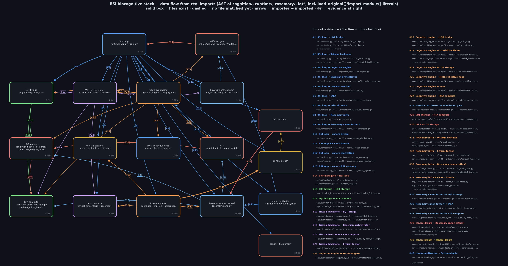
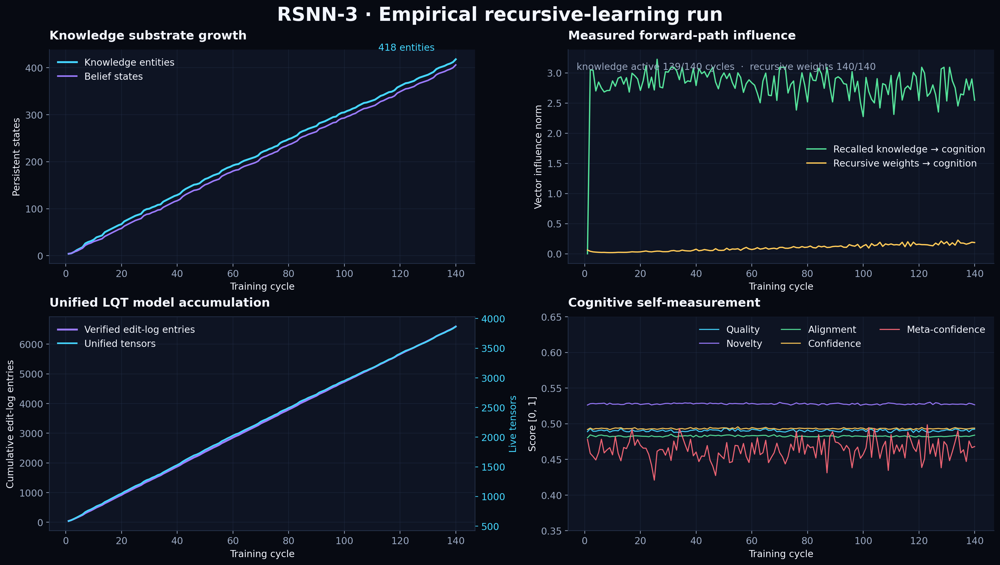
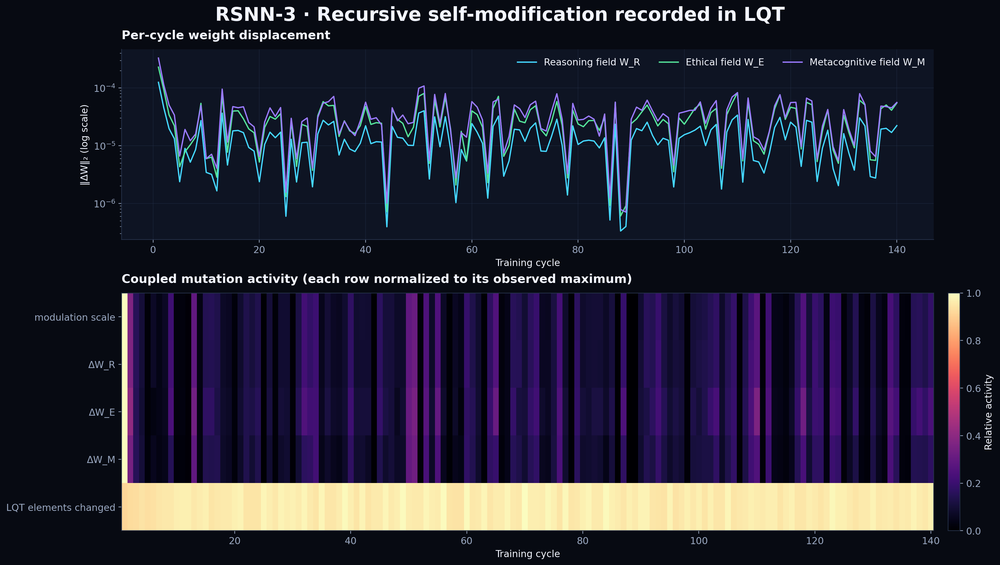
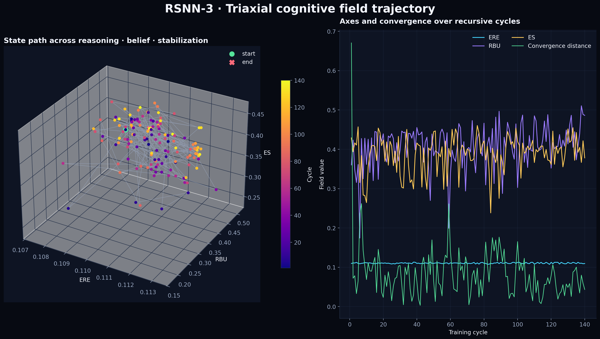
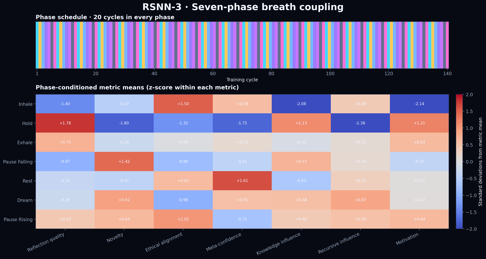
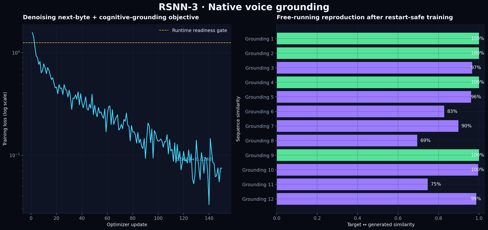
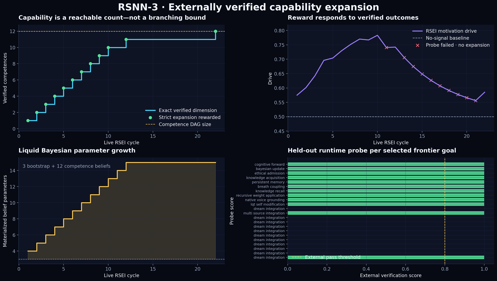

<!--
  RSNN-3 README draft, written 2026-11-21 from calisweetleaf/RSNN-3@main (read only, nothing edited).
  Every number below comes from a file in the repository. The file is named next to each number.
  Template slots are HTML comments that start with "TODO:", so you can search for them and fill them in.
-->

<p align="center">
  <a href="https://github.com/calisweetleaf/RSNN-3" rel="noopener">
    
  </a>
</p>
<!-- TODO: logo. GitHub strips CSS, so the image file itself has to be the circle. Use a square PNG with a transparent background and a round mark, 400x400 or larger. -->

<h3 align="center">RSNN-3</h3>

<div align="center">

[]()
[]()
[](https://www.python.org/)
[](https://pytorch.org/)
[]()
[]()
[]()


</div>

---

<p align="center">
  RSNN-3 is a recursive cognitive system that learns while it runs. It admits knowledge, keeps it across restarts, recalls it in later thought, executes its own evolved recursive weights, and writes every change it makes to itself into one hash-chained, rollback-capable model file. Nothing here is an external LLM in a costume. The chat surface shows exactly what the system recalled and computed, and nothing it did not.
  All things contained in this repository are under the terms of the Somnus Sovereign Anti-Exploitation License, <a href="https://github.com/calisweetleaf/somnus-license">somnus-license</a>.
</p>
<!-- TODO: the repository has no LICENSE file yet. Add one before release, or change this line. -->

---

## Table of Contents

- [At a Glance](#at-a-glance)
- [About](#about)
- [What Changed in RSNN-3](#what-changed-in-rsnn-3)
- [Architecture](#architecture)
- [Evidence](#evidence)
- [Getting Started](#getting-started)
- [Usage](#usage)
- [Native Voice](#native-voice)
- [RSEI Capability Incentive](#rsei-capability-incentive)
- [Self-Modification Gate](#self-modification-gate)
- [LQT: The Model File](#lqt-the-model-file)
- [Honest Limits](#honest-limits)
- [Repository Structure](#repository-structure)
- [Built Using](#built-using)
- [Authors](#authors)
- [License](#license)

---

## At a Glance

This section is the thirty-second version for someone deciding whether to keep reading.

| Question | Answer |
|---|---|
| What is it? | A cognitive loop: breath phase, cognitive engine, sentinel, Bayesian beliefs, motivation, learning, self-modification, episodic memory, dream. All of its state lives in one native `model.lqt` file. |
| Does it actually learn? | Yes. In the clean release run, 140 of 140 learning attempts were admitted and 139 of 140 later steps used something learned earlier. |
| Does it survive a restart? | Yes. 3,866 tensors were saved and reloaded with 0 mismatches, and the same model resumed. |
| Can it undo itself? | Yes. One-step and five-step rollbacks both restored the state exactly and left the edit log valid. |
| Does it talk? | It has a small learned byte-level voice. Until that voice is trained enough, chat shows recalled knowledge and computed state instead of inventing text. |
| What runs it? | Python 3.12 plus a C++17 LQT library bound through pybind11. CPU is enough. |

---

## About

This section explains what RSNN-3 is for and the one rule it holds itself to.

RSNN-3 is the third generation of a recursive symbolic neural system. The goal isn't a chatbot. It's a system whose learning is real, inspectable, and persistent: when it learns something, you can find it in the model file, see where it was used, roll it back, and verify the whole history.

The rule it holds itself to is simple. **No faked capability.** If a part of the system can't do something yet, the system says so. It doesn't paper over the gap with a template or a borrowed model. The language head and the tutor boundary in the [Native Voice](#native-voice) section are where that rule matters most.

Some historical module and directory names, such as `rosemary`, remain because the runtime imports them. They describe lineage, not the identity or purpose of the system.

<!-- TODO: optional "How RSNN-3 Fits" paragraph tying it to RSI / Somnus / Operation SOTA, if you want it public. -->

---

## What Changed in RSNN-3

This section lists the repairs that turned the previous generation into a system that learns end to end. Each one fixed a real failure. Full detail is in `RSNN3_REPAIR_REPORT.md`.

| # | Before | Now |
|---|---|---|
| 1 | The ethics filter treated "no ethical keywords" as negative evidence, so every technical passage was rejected | Neutral content gets a neutral prior. Ethical valence still modulates admission |
| 2 | Seeing the same content again erased its evolved weight | Content hashes are stable identities, so re-observation is idempotent |
| 3 | Unrelated ideas were flagged as contradictions | A contradiction requires directional opposition, not just dissimilarity |
| 4 | "Autonomous acquisition" wrote a sentence claiming it had learned something | It now pulls an unseen, attributed passage from the local corpus and learns it for real |
| 5 | Learned representations sat beside cognition, unused | Selected entities feed the existing attention layer and measurably change thought |
| 6 | Recursive weights accumulated but never ran | They now execute in the forward pass and modulate encoded thought |
| 7 | Graph identity, beliefs, owners and cycle state were lost on reload | The unified LQT stack rebuilds every owner before tensors are applied |
| 8 | Training and chat rebuilt the model differently | Both share one reconstruction path |
| 9 | Motivation could create state after a checkpoint was taken | Formation threads drain before every observe, sync or save |
| 10 | Rollback restored tensors but not the knowledge graph | Rollback restores both |
| 11 | Some admitted knowledge bypassed memory or the graph | All admitted knowledge stays visible to cognition |
| 12 | Transcripts hid what the system changed | Every turn records its learning and influence |
| 13 | Motivation sat at an inert 0.500 baseline | It's driven by externally verified capability gains (RSEI) |
| 14 | Bayesian beliefs were capped at 3 | Beliefs grow with the capability frontier (3 grew to 15 in the live run) |
| 15 | The breath phase reset every session, which could postpone DREAM indefinitely | Breath identity persists across restarts |
| 16 | The language head picked fixed sentences | A recurrent UTF-8 byte voice conditioned on live state, gated until it's trained enough |

---

## Architecture

This section shows how one turn moves through the system and where its state ends up.

### One Turn, End to End

```
INPUT: your text
  |
  v
CANON BREATH PHASE
  |  INHALE -> PAUSE_RISING -> HOLD -> EXHALE -> PAUSE_FALLING -> REST -> DREAM
  |  (phase persists across restarts; it sets learning intensity)
  |
  v
COGNITIVE ENGINE
  |  Triaxial backbone on LQT-stored weights
  |  + RTA attention over learned IALA entities      <-- learned knowledge re-enters here
  |  + recursive weights executed on the thought-encoder row bank
  |  + ethical / metacognitive / meta-reflective heads
  |
  v
SECT SENTINEL ------------------> Bayesian update (Beta beliefs, grows with the frontier)
  |
  v
MOTIVATION (canon FBS tokenizer; drive set by RSEI reward)
  |
  v
IALA  learn_from_text + training cycle
  |  ethical admission (neutral prior) -> knowledge graph -> RWA weights
  |
  v
PSI SELF-MODIFICATION  (quantized into the LQT store)
  |
  v
RSL EPISODIC MEMORY
  |
  +-- on DREAM phase: dream portal integrates memories
  |
  v
UnifiedModel.sync  -->  every changed tensor written to model.lqt
                        as a CRC-chained, verifiable edit log entry
```

### Where the Reply Comes From

```
           +-------------------+
           |  native voice     |  trained enough? (>= 20 real updates
           |  (byte decoder)   |  and loss at readiness)
           +---------+---------+
                     | no
                     v
   +-----------------------------------------------+
   | auditable rendering                           |
   |   recall : IALA entities (RTA select)         |
   |            + RSL episodic / dream memories    |
   |   dream  : memories integrated on DREAM exit  |
   |   state  : mode, reflection scores, filter    |
   |            verdict, breath phase, drive       |
   +-----------------------------------------------+
```

### What Persists

| State | Where it lives |
|---|---|
| All float state | `model.lqt` tensors |
| Entity identity (recursive weights, IALA RWA weights and texts, motivation entities), RSL records, RSEI ledger, Bayesian schemas, breath coordinate | `unified.stack` JSON in the model's module graph, rebuilt before tensors load |
| Tensors whose owner can't be rebuilt | Kept untouched as "dormant", listed in the startup banner, never detached |
| Not persisted | Motivation experience queues and RSL internal tensors (records are re-stored on load) |

<!-- TODO: if you want a rendered diagram here, runtime/viz/out/architecture.png already exists:
<p align="center"></p>
-->

---

## Evidence

This section lists measured results from real runs. Every figure is generated from run artifacts, and their source hashes are recorded in `visualizations/figures/figure_manifest.json`.

### Clean Release Run (`runtime/runs/rsnn3_release_seed1`, 140 steps, seed 1)

| Measure | Result |
|---|---|
| Cycles completed | 140 / 140 |
| IALA admissions | 140 / 140 |
| Later steps that used learned knowledge | 139 / 140 (step one has nothing to recall) |
| Steps executing recursive cognitive weights | 140 / 140 |
| Final knowledge entities | 418 |
| Final Bayesian belief states | 406 |
| Breath phases exercised | All seven, including DREAM |
| Tensors saved and reloaded | 3,866, exact equality, 0 mismatches |
| Native edit-log entries | 6,595, chain verified |
| Rollback (1 step and 5 steps) | Exact, edit log valid |

### Figures

<p align="center">
  
  <br><em>Figure 1. Recursive learning evidence</em>
</p>

<p align="center">
  
  <br><em>Figure 2. LQT self-modification</em>
</p>

<p align="center">
  
  <br><em>Figure 3. Triaxial cognitive dynamics</em>
</p>

<p align="center">
  
  <br><em>Figure 4. Breath phase coupling</em>
</p>

<p align="center">
  
  <br><em>Figure 5. Native voice learning</em>
</p>

<p align="center">
  
  <br><em>Figure 6. RSEI verified capability</em>
</p>

<!-- TODO: add a one-sentence caption under each figure saying what to look at. -->

---

## Getting Started

This section gets you from a clone to a running chat.

### Prerequisites

- Python 3.12
- CMake 3.16 or newer, Ninja, and a C++17 compiler
- Git LFS (`*.lqt` model files are stored in LFS)
- CPU is enough. Use the PyTorch CPU wheel index to avoid pulling CUDA.

### Installation

```bash
git clone https://github.com/calisweetleaf/RSNN-3
cd RSNN-3
git lfs pull

python3.12 -m venv .venv
source .venv/bin/activate

pip install numpy torch scipy networkx pyyaml matplotlib requests psutil \
            pybind11 prometheus-client lz4 cryptography pydantic
```

### Build the native LQT module

```bash
cmake -S bindings -B bindings/build -G Ninja -DCMAKE_BUILD_TYPE=Release \
      -Dpybind11_DIR=$(python -c 'import pybind11;print(pybind11.get_cmake_dir())')
cmake --build bindings/build --target lqt_native -j
```

The build copies `lqt_native*.so` into `lqt_py/`. x86-64 builds get AVX2 automatically, and aarch64 uses NEON. Check that it loads:

```bash
python -c "from cognition.lqt_bridge import get_backend; print(get_backend('native').L.LqtModel)"
```

---

## Usage

This section covers the three ways you'll actually run RSNN-3.

### Talk to the recovered model

```bash
python -m runtime.chat --model runtime/runs/rsnn3_recovered/model.lqt
```

### One turn, save, exit

```bash
python -m runtime.chat --model <path/to/model.lqt> --once "your sentence"
```

### Continue training the release model

```bash
python -m runtime.train --steps 14 --seed 1 --out runtime/runs/rsnn3_release_seed1 --overwrite
```

`--overwrite` lets you reuse the run directory. The existing model is resumed, not replaced.

### Chat commands and flags

| Command / flag | What it does |
|---|---|
| `/state` | Show the current cognitive state |
| `/save` | Write to `model.lqt` now |
| `/rollback N` | Undo the last N turns' logged edits |
| `/teach TARGET` | Ground the previous turn's state with a target reply (voice weights only) |
| `/quit` | Save and exit |
| `--save-every N` | Save every N turns (default 5; 0 saves only on exit) |
| `--mrc` | Run the slow REST-phase MRC fixed point |
| `--iala-filter` | `selfmod` or `THRESHOLD,PRIOR` (default prior 1.0, threshold 0.5) |
| `--json` | Full per-turn learning and influence record |

Working files go to `<model dir>/chat/`: `transcript.jsonl`, `chat.log`, and the Bayesian state.

---

## Native Voice

This section explains how RSNN-3 speaks and why a tutor can never change what it believes.

The native voice is a small recurrent UTF-8 byte decoder inside the cognitive engine. It's conditioned on the live cognitive state at every step and trained with next-byte cross entropy plus a state-reconstruction grounding loss. It replaced a 50,000-entry token table in which 49,500 entries were `<ext_N>` placeholders.

```
  prompt --> full RSNN-3 loop --> cognitive state --+
                                                    v
                                     native voice (byte decoder) --> reply bytes
                                                    ^
  target / tutor text --- supervised label only ----+
        |
        x--- never enters IALA, RSL memory, Bayesian beliefs,
             the engine input, or the recursive reasoning field
```

Ground it with your own pairs (`prompt`/`target` or `user`/`response` JSONL):

```bash
python -m runtime.train_native_voice \
  --model runtime/runs/rsnn3_release_seed1/model.lqt \
  --dataset voice_pairs.jsonl --epochs 3 --updates-per-example 4
```

Or use an OpenRouter model as a speech tutor:

```bash
export OPENROUTER_API_KEY=...
python -m runtime.train_native_voice \
  --model runtime/runs/rsnn3_release_seed1/model.lqt \
  --teacher-model provider/cheap-instruct-model
```

The tutor only sees a bounded rendering of the current state and is told to verbalize only that state. Leave out `--teacher-model` for the built-in baseline with no network dependency.

---

## RSEI Capability Incentive

This section explains how RSNN-3's motivation is tied to things it has provably done, not things it claims.

`runtime/rsei_incentive.py` watches the live loop from outside the cognitive forward path and turns demonstrated behavior into capability evidence. Capability is the exact count of externally verified competences in a 12-node DAG. Reward requires a strict expansion of that set. Reflection, confidence, and self-description can't certify anything.

| Competence DAG (12) | |
|---|---|
| cognitive forward | ethical admission |
| Bayesian update | knowledge acquisition |
| knowledge recall | recursive-weight application |
| LQT self-modification | persistent memory |
| breath coupling | dream integration |
| native-voice grounding | multi-source integration |

**Live result (22 cycles):** 12 of 12 verified, 12 strict expansions, final frontier 0, Bayesian parameters grew from 3 to 15, 10,029 edit-log entries with the chain valid after restart.

Dream integration failed its probe 10 times and earned nothing. Drive fell instead of paying itself. It passed only after a real DREAM enter, advance and exit that integrated three memories. Drive peaked at 0.783.

---

## Self-Modification Gate

This section explains how RSNN-3 is allowed to change its own policy code, and what it isn't allowed to touch.

The gate is the running system itself. A candidate edit to `cognition/mutable/` is applied, the live loop runs on fixed seeds 0 to 4 plus two fresh seeds, and the edit is kept only if the system's own metric improves:

```
J = -NLPD_heldout + 10 * reflection_quality_heldout
```

An edit is kept only if all four hold: the mean fixed-seed gain beats `min_delta` and is positive on at least 4 of 5 seeds; the fresh-seed gain is positive; every seed stays healthy (finite weights, bounded growth, all Bayesian updates succeed, IALA learning doesn't drop); and invariants I1 to I3 hold. The rules were pre-registered before the first generation ran. See `runtime/selfmod/PREREGISTRATION.md`.

**Protected from the loop:** `runtime/selfmod/**`, `cognition/mutable/__init__.py`, the IALA ethics-filter setting, and all engine and runtime code outside `cognition/mutable`.

---

## LQT: The Model File

This section explains the file format that makes persistence, audit, and rollback possible.

LQT (Liquid Quantized Format, v1.3) is an editable post-quantization container. Codebooks can be revised, deltas injected, modules hot-swapped, and sparsity masks updated without re-quantizing the model. Every mutation is validated, applied atomically, and appended to a tamper-evident CRC-chained edit log. GGUF and ONNX offer none of that.

| Region | Contents |
|---|---|
| FileHeader (36 B) | Magic, version 0x0103, offsets, flags |
| TLV Metadata | Hyperparams, module graph (`unified.stack` lives here), tables |
| Codebooks | Scalar / vector / hierarchical, FP16, mutable in place |
| Tensors | Packed quantized indices |
| Deltas / Sparse Masks | Dense or sparse FP16/FP32 deltas; bitmap or RLE masks |
| FileFooter (64 B) | Offsets and a whole-file CRC-32 |

The C++17 reference library is in `lqt/` (modules A1 to A10, with 237 registered tests that all passed at the 2026-09-20 manual gate). Its own README, `lqt/README.md`, covers the format in depth.

---

## Honest Limits

This section says plainly what RSNN-3 doesn't do yet, so nobody has to find out the hard way.

- **Language quality is small-data-limited.** The native voice works and survives restarts, but occasional spelling corruption remains. It isn't presented as solved.
- **The chat isn't a generator.** Until the voice is ready, replies are recalled knowledge plus computed state. No external LLM was added.
- **The prebuilt native module targets CPython 3.12 on Linux x86-64 only.** Rebuild it for anything else.
- **The model files are in Git LFS.** Without `git lfs pull` you get 134-byte pointers instead of models.
- **Results come from a small configuration** (hidden dim 64, CPU). Scale-up hasn't been run.

---

## Repository Structure

This section maps the tree so you can find the part you care about.

```
RSNN-3/
├── cognition/                        # Cognitive engine and organs
│   ├── cognitive_engine.py           # Engine: backbone, RTA attention, recursive weights, voice
│   ├── triaxial_backbone.py          # Triaxial backbone on LQT-stored weights
│   ├── ursmif_lobe.py                # URSMIF self-monitoring lobe
│   ├── meta_reflective_head.py       # Meta-reflective output head
│   ├── lqt_bridge.py                 # Python <-> native LQT backend
│   ├── weight_evolution_engine.py    # Recursive weight evolution
│   └── mutable/                      # The only code the self-mod loop may edit
│
├── runtime/                          # Running the system
│   ├── chat.py                       # Interactive chat on a model.lqt
│   ├── train.py                      # Native training loop
│   ├── train_native_voice.py         # Voice grounding / tutor training
│   ├── rosemary_full.py              # Full loop (historical name, retained for imports)
│   ├── rsei_incentive.py             # External capability verifier and reward
│   ├── selfmod/                      # Pre-registered self-modification gate (protected)
│   ├── viz/                          # Dashboards and architecture render
│   └── runs/                         # Release and recovered runs (models in LFS)
│
├── lqt/                              # LQT v1.3 C++17 reference library, specs, whitepapers
├── bindings/                         # pybind11 module (lqt_native)
├── lqt_py/                           # Built native module lands here
├── rosemary/                         # Canon organs: breath, dream, emotion, memory, motivation
├── visualizations/figures/           # Six evidence figures + provenance manifest
├── daerons-internal-theorem-fullstack/  # Theory corpus and canon code
│
├── RSNN3_REPAIR_REPORT.md            # What was repaired and how it was measured
├── RSEI_INTEGRATION.md               # Capability incentive design and live result
├── NATIVE_VOICE.md                   # Voice design and tutor boundary
└── CHAT.md                           # Build and chat reference
```

---

## Built Using

This section credits the tools RSNN-3 stands on.

- [PyTorch](https://pytorch.org/) for the cognitive engine and training
- [NumPy](https://numpy.org/) and [SciPy](https://scipy.org/) for numerical computing
- [NetworkX](https://networkx.org/) for the knowledge graph
- [pybind11](https://github.com/pybind/pybind11) for the C++ to Python binding
- [Matplotlib](https://matplotlib.org/) for the evidence figures
- C++17 and CMake for the LQT reference library

---

## Authors

This section names who built it.

- **Daeron Blackfyre** ([calisweetleaf](https://github.com/calisweetleaf)), Somnus Sovereign Systems: architect and developer

---

## License

This section states the terms the work is released under.

Released under the Somnus Sovereign Anti-Exploitation License. See [somnus-license](https://github.com/calisweetleaf/somnus-license).
<!-- TODO: add the LICENSE file to the repo root. -->
