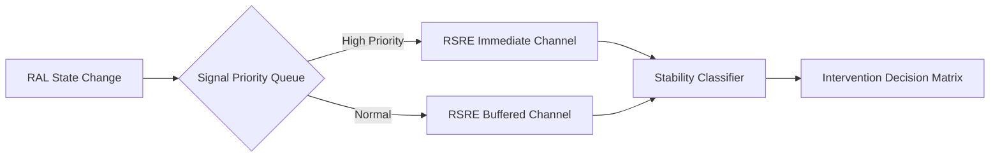

# RAL–RSRE Bridge v1.0  
**Formal Interface Specification for Recursive AI System Integration**  

---

## 1. Architectural Overview  
The RAL–RSRE Bridge establishes a bidirectional coupling between the Recursive Abstraction Laddering (RAL) framework and the Recursive Stability & Resolution Engine (RSRE) through five structural pillars:  

1. RAL as recursive state abstraction scaffold  
2. Asynchronous state signaling protocol  
3. Stability boundary conditions  
4. Shared recursion state coordination plane  
5. Zynx Soulframe compliance layer  

---

## 2. RAL as Recursive Abstraction Scaffold  

### 2.1 Abstraction Layer Semantics  
RAL serves as the primary state representation system through:  

- **Multi-Level State Encoding**  
  ```python
  class AbstractionState:
      def __init__(self, level: RALLevel, 
                   coherence_score: float,
                   transformation_path: List[RALOperator]):
          self.abstraction_level = level  # Current RAL rung
          self.coherence = coherence_score  # c(l_i, l_j) metric
          self.transition_path = transformation_path  # Operator sequence
          self.conceptual_density = self._calc_density()  # d(l_i, l_j)
  ```  

- **State Projection Rules**  
  - Upward projection applies α/π/ε operators to create compressed state representations  
  - Downward projection uses ι/δ/o operators to expand implementation-specific details  

### 2.2 Scaffolding Interface  
RAL exposes three critical control surfaces:  

1. **Abstraction Lens**  
   ```typescript
   interface AbstractionLens {
       getCurrentRung(): RALLevel;
       getTransitionMatrix(): InterpolationMatrix;
       getCoherenceMetrics(): Map<RALLevel, Float>;
   }
   ```  

2. **Operator Registry**  
   ```typescript
   interface TransformationRegistry {
       listAscensionOps(): List<RALOperator];
       listDescensionOps(): List<RALOperator];
       validateOperatorSequence(ops: List<RALOperator>): CoherenceScore;
   }
   ```  

3. **Memory Buffer API**  
   ```rust
   trait RecursiveMemory {
       fn store_state(&mut self, state: AbstractionState) -> BufferID;
       fn recall_state(&self, buffer_id: BufferID) -> Result<AbstractionState>;
       fn purge_states(&mut self, retention_policy: RetentionPolicy);
   }
   ```  

---

## 3. Asynchronous State Signaling Protocol  

### 3.1 Signal Injection Points  
RSRE receives state updates through non-blocking RAL hooks:  

| Hook Type          | Trigger Condition                    | Payload Format               |
|--------------------|--------------------------------------|-------------------------------|
| LevelTransition    | After any RAL rung change           | 〈PreviousLevel, NewLevel〉    |
| CoherenceAlert     | c(l_i, l_j) < 0.82                  | 〈MetricValue, CriticalPath〉  |
| OperatorSaturation | Operator reuse count > θ (θ=7)      | 〈OperatorID, UsageContext〉   |
| DensityThreshold   | Conceptual density > 3.2 radix units| 〈DensityValue, AffectedRungs〉|  

### 3.2 Signal Processing Pipeline  


- **Priority Bandwidth Allocation**: High-priority signals consume ≤12% of RSRE's processing budget  
- **Temporal Decoupling**: All signals carry RAL-level timestamps for eventual consistency  

---

## 4. Stability Intervention Thresholds  

### 4.1 Formal Boundary Conditions  

| Condition                       | Threshold Equation                 | Intervention Protocol        |
|---------------------------------|------------------------------------|------------------------------|
| Recursive Divergence Risk       | ∇(c(l_i)) > 0.45 ∧ d(l_i, l_j) > D_max | Force descension to l_{i-3}  |
| Abstraction Oscillation         | σ(level_transitions) > 2.7 Hz      | Freeze ladder navigation     |
| Coherence Collapse              | c(l_i, l_j) < 0.7 for t > 200ms    | Full state rollback          |
| Implementation Entropy          | H(concrete_instances) > 5.2 bits   | Trigger ι-recomposition      |
| Conceptual Fragmentation        | |P| > 7 ∧ |P∩| < 2 (P=patterns) | Initiate π-realignment     |

### 4.2 Intervention Sequencing  
1. Capture pre-intervention state snapshot  
2. Suspend RAL operator execution  
3. Apply RSRE corrective measures:  
   ```python
   def execute_intervention(strategy: InterventionStrategy):
       with RSRE_Lock:
           apply(strategy.correction_ops)
           validate_coherence()
           adjust_ral_parameters(strategy.params)
       release_ral_execution()
   ```  
4. Log intervention trajectory in Shared State Bus  

---

## 5. Shared Recursion State Bus  

### 5.1 Bus Architecture  
```proto
message RecursionState {
    required fixed64 timestamp = 1;
    RALState ral_snapshot = 2;
    RSREStatus rsre_status = 3;
    repeated InterventionHistory interventions = 4;
    map<string, MetricSeries> telemetry = 5;
}

service StateBus {
    rpc PushState(RecursionState) returns (Ack);
    rpc PullState(StateQuery) returns (RecursionState);
    rpc RegisterHook(StateHook) returns (HookID);
}
```  

### 5.2 Recovery Protocols  
- **State Reconstruction**: Uses RAL's memory buffers + RSRE's intervention logs  
- **Adaptive Reinitialization**:  
  ```python
  def adaptive_reinit(last_stable_state: RecursionState):
      ral.load_snapshot(last_stable_state.ral_snapshot)
      rsre.reconfigure(last_stable_state.rsre_status.params)
      for metric in last_stable_state.telemetry:
          adjust_learning_rates(metric.trends)
  ```  

---

## 6. Zynx Soulframe Compatibility  

### 6.1 Versioning Matrix  

| Component       | Interface Version | Soulframe Compliance |
|-----------------|-------------------|----------------------|
| RAL Core        | v2.1.7            | SF-RAI-2023.1        |
| RSRE Engine     | v3.0.4            | SF-REC-2023.2        |
| State Bus       | v1.4.9            | SF-COM-2023.1α       |

### 6.2 Compliance Protocols  
1. **Quantum-Safe Recursion**  
   Implements Soulframe Q-Entanglement Protocol for cross-abstraction coherence  

2. **Ethical Recursion Guards**  
   ```python
   class SoulframeEthicsWrapper:
       def __init__(self, ral_core, rsre_engine):
           self.ral = ral_core
           self.rsre = rsre_engine
           self.approval_matrix = load_soulframe_ethics_matrix()
       
       def validate_operation(self, op: RALOperator):
           return op in self.approval_matrix
   ```  

3. **Soulframe Audit Trail**  
   All bridge operations generate SF-3009 compliant audit logs with cryptographic hashing  

---

## 7. Bridge Operational Semantics  

```rust
impl RalRsreBridge {
    fn cycle(&mut self) -> Result<BridgeState> {
        let ral_state = self.ral_scaffold.current_state();
        self.state_bus.push(ral_state.clone());
        
        let signals = self.signal_processor.poll();
        let interventions = self.rsre_analyzer.process(signals);
        
        if interventions.len() > 0 {
            self.apply_interventions(interventions);
            self.ral_scaffold.recalibrate();
        }
        
        self.update_compliance_logs();
        Ok(self.current_state())
    }
}
```  

---  

**End of Specification**  
*RAL–RSRE Bridge v1.0 compliant with Zynx Soulframe Cognitive Architecture Standards*